# Vista general — modelo conceptual (todas las capas)

> Mapa global coherente. El detalle fino vive en `../detalle/` y en `builder/spec/`.
> Generado a mano a partir de los specs; los conteos salen de `builder/out/diccionario.csv`.

## Diagrama de capas

```mermaid
flowchart TB
  subgraph L0["L0 · NÚCLEO (core_) — transversal"]
    PR[proyecto] --> CO[componente]
    UGT[ugt] --> CT[ct]
    PER[persona] --> USR[usuario]
    ROL[rol] --> USR
    IE["ie (IE × Nivel)"]
    ET[etapa]
    PE[periodo]
    CAT[catálogo] --> CIT[catálogo_item]
    ACT[actividad] --> SES[sesión]
    SES --> EVI[evidencia]
    EVE[evento · auditoría]
  end

  subgraph L1["L1 · DOMINIOS"]
    subgraph PRG["programacion (prog_)"]
      AG[poa_actividad_grande] --> AP[actividad_pequena]
      AP --> REP[reporte] --> INC[incidencia]
    end
    subgraph INS["instrumentos (inst_)"]
      INSTR[instrumento] --> ITEM[item]
      INSTR --> INT[intento] --> RESP[respuesta]
    end
    subgraph CCA["cca (cca_)"]
      ROS1[roster] --> AS1[asistencia]
      SES1[sesion] --> AS1
      SES1 --> SEG[seguimiento_ie]
    end
    subgraph MS["mente_sana (ms_)"]
      ROS2[roster] --> AS2[asistencia]
      SES2[sesion] --> AS2
      SES2 --> EVAL[evaluacion_estudiante]
    end
    subgraph PDL["pdle (pdle_)"]
      PS[programa_sesion] --> PP[participante] --> PEV[evaluacion]
    end
    subgraph AJ["academia_juvenil (aj_)"]
      HAB[habilidad] --> EH[evaluacion_habilidad]
      PA[participante] --> EH
      PA --> CAR[cartilla]
    end
  end

  IE -.-> PRG
  IE -.-> CCA
  IE -.-> MS
  IE -.-> PDL
  IE -.-> AJ
  SES -.-> CCA
  SES -.-> MS
  SES -.-> PDL
  INT -.-> CCA
  INT -.-> MS
  INT -.-> PDL
  CIT -.-> L1
```

## Cómo se reutiliza el núcleo (lo que hace coherente CCA + MS)
- **IE × Nivel** (`core_ie.cod_unico`): CCA y MS comparten instituciones; MS distingue Primaria/Secundaria → una sola entidad con `cod_unico`. Evita IE duplicada.
- **Persona (DNI) + roster**: las personas de los rosters se consolidan en `core_persona`; el roster guarda el texto tal como se escribió y la FK al consolidar.
- **Sesión** (`core_sesion`): unidad común de "algo ejecutado". CCA/MS/PDLE cuelgan su sesión de aquí y comparten `core_evidencia`. Mata el `Cod_mirror` de texto.
- **Instrumentos**: Docentes/Familias (CCA y MS) y Estudiantes (MS) son el mismo motor; cambia la definición de ítems, no la tabla.
- **Catálogos con color**: estados, componentes, UGT → `core_catalogo_item.color_hex`, exactamente lo que el UI ya usa.

## Cobertura por proyecto
- **Programación**: 5 tablas propias + núcleo. AG (solo Admin) → pequeñas (usuarios) → reporte → incidencia/alerta.
- **CCA**: 4 tablas + instrumentos (Docentes 30+4, Familias 24+2) → migra las 11 pestañas.
- **Mente Sana**: 4 tablas + instrumentos (Docentes 24+3, Familias 23+3) + módulo Estudiante.
- **PDLE / Academia Juvenil**: esqueleto listo para enchufar datos (3 y 4 tablas).

## Totales del builder
- 8 capas · 43 tablas · 328 columnas · 0 incoherencias (`builder/out/coherencia.md`).
- Padrón cargado: 4 983 IE×Nivel, 216 membresías IE×componente (`builder/out/padron_*.csv`).

## Capa padrón (fuente real de IIEE/localización)
- `pad_escuela` (detalle ESCALE 1:1 con `core_ie`) + `pad_escuela_componente` (membresías).
- Cuelga de `core_ie` (que ya no es inventada: `cod_mod` y `cod_inst` vienen del ESCALE).
- UGT asignada por IE: San Marcos 220, Valle Fortaleza 124, Huallanca 59, Huarmey 55, Mina 36.
- Flags → componente: PDL 63, QM 32, PDLD 31, LECTO 26, CCA 32, MS 24, AJ 8, PDLE 0.
